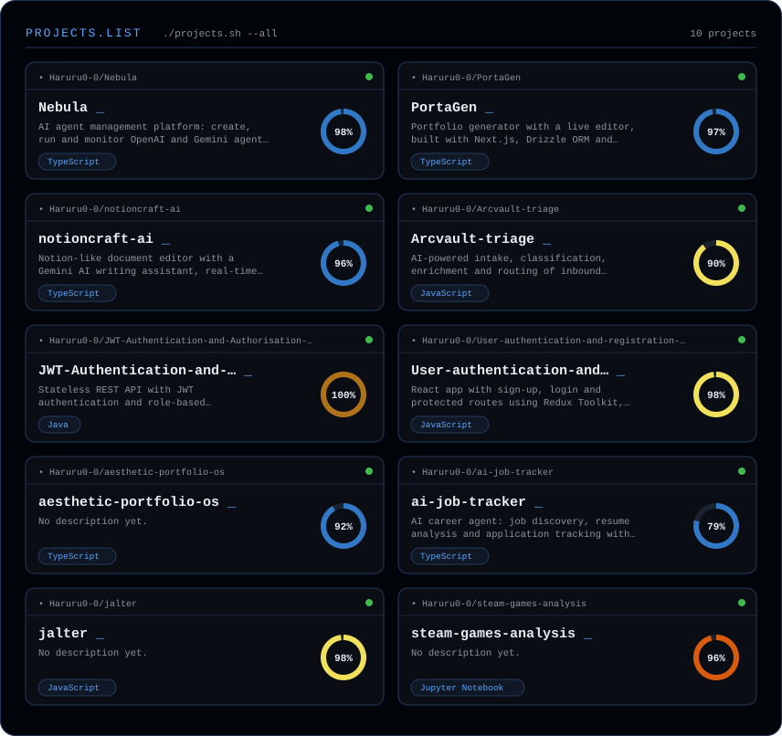

<div align="center">

<code>haruru0-0@github ~ $ neofetch --live</code>




● **ONLINE** · Full Stack Developer in Tripoli, Lebanon. Building AI-powered products with Spring Boot, React and PostgreSQL.

</div>

## `$ tail -n 5 /var/log/build.log`

```text
[ok] identity loaded: Ahmad Kanaan
[ok] role detected: Full Stack Developer
[ok] experience: 5 years of enterprise apps, teams of 5-7, 10+ developers mentored
[ok] primary stack: Spring Boot · React · Next.js · TypeScript · PostgreSQL
[run] Building AI-powered products on my own.
```

[Portfolio](https://ahmad-kanaan.vercel.app) · [Blog](https://ahmadkanaan.hashnode.dev)

## `$ git launchpad --all`

<div align="center">



</div>

| Project | What it does | Stack |
|---|---|---|
| [**Nebula**](https://github.com/Haruru0-0/Nebula) ([live](https://nebula-gamma-inky.vercel.app)) | AI agent control center. Create, configure and monitor LLM agents across OpenAI and Gemini, with live token, latency and cost metrics. | Next.js, Node/TypeScript, PostgreSQL, WebSocket, Docker |
| [**notioncraft-ai**](https://github.com/Haruru0-0/notioncraft-ai) ([live](https://notioncraft-ai.vercel.app)) | A Notion-style document editor with an inline Gemini writing assistant and real-time collaboration. | Next.js, Vercel AI SDK, Supabase, Drizzle, Yjs |
| [**PortaGen**](https://github.com/Haruru0-0/PortaGen) ([live](https://porta-gen.vercel.app)) | Portfolio generator with a live editor and a component-first architecture. | Next.js, TypeScript, Drizzle, PostgreSQL |

## `$ which --all toolchain`

<div align="center">



| **TypeScript**<br/>69% | **Jupyter Notebook**<br/>17% | **JavaScript**<br/>10% | **CSS**<br/>3% | **Python**<br/>1% | **Shell**<br/>0% |
| --- | --- | --- | --- | --- | --- |

</div>

## `$ cat highlights.md`

- Built an OpenAI automation pipeline that cut manual development time by 20%.
- Led 3 high-profile projects to delivery with 95%+ client satisfaction.
- Shipped React Native apps to both the App Store and Google Play.
- Wrote the Spring Boot and React training curriculum and ran workshops for 15+ people.

## `$ git status --short`

<div align="center">

**working tree: clean · shipping consistently**



</div>

## `$ git log --graph --all`

<div align="center">



</div>

## `$ ssh haruru0-0@github`

Off the keyboard: UI/UX design, 3D modeling, chess, reading manga. Languages: English, French, Arabic.

<div align="center">


</div>
